# KDAM — KDE Avatar Manager: Full Architecture

> [!NOTE]
> KDAM (`kde-avatar-manager`) is a Python CLI tool that auto-rotates KDE Plasma user avatars on a configurable schedule, with an interactive crop editor, systemd timer integration, panic/safe-image support, and a portable backup system.

---

## Table of Contents

1. [Project Overview](#1-project-overview)
2. [Repository Layout](#2-repository-layout)
3. [High-Level Architecture](#3-high-level-architecture)
4. [Module Breakdown](#4-module-breakdown)
   - [Package Entry Point](#41-package-entry-point)
   - [config.py — Configuration & Paths](#42-configpy--configuration--paths)
   - [db.py — Image Registry](#43-dbpy--image-registry)
   - [scanner.py — Directory Scanner](#44-scannerpy--directory-scanner)
   - [rotator.py — Rotation Engine](#45-rotatorpy--rotation-engine)
   - [editor.py — Crop Editor (PyQt5)](#46-editorpy--crop-editor-pyqt5)
   - [kde.py — D-Bus / AccountsService Bridge](#47-kdepy--d-bus--accountsservice-bridge)
   - [notify.py — Desktop Notifications](#48-notifypy--desktop-notifications)
   - [backup.py — Backup & Restore](#49-backuppy--backup--restore)
   - [_cli_shared.py — Shared CLI Utilities](#410-_cli_sharedpy--shared-cli-utilities)
   - [cli.py — Root CLI Group & Leaf Commands](#411-clipy--root-cli-group--leaf-commands)
   - [cli_config.py — Config Sub-group](#412-cli_configpy--config-sub-group)
   - [cli_dirs.py — Dirs Sub-group](#413-cli_dirspy--dirs-sub-group)
   - [cli_panic.py — Panic Sub-group](#414-cli_panicpy--panic-sub-group)
   - [cli_backup.py — Backup Sub-group](#415-cli_backuppy--backup-sub-group)
5. [Data Model](#5-data-model)
6. [Data Flow Diagrams](#6-data-flow-diagrams)
   - [Normal Rotation Cycle](#61-normal-rotation-cycle)
   - [Panic Reset Flow](#62-panic-reset-flow)
   - [Crop Editor Integration](#63-crop-editor-integration)
   - [Backup & Restore Flow](#64-backup--restore-flow)
7. [File System Layout at Runtime](#7-file-system-layout-at-runtime)
8. [Concurrency & Safety Model](#8-concurrency--safety-model)
9. [Systemd Integration](#9-systemd-integration)
10. [Rotation Modes & Selection Orders](#10-rotation-modes--selection-orders)
11. [CLI Command Reference Tree](#11-cli-command-reference-tree)
12. [Dependency Graph](#12-dependency-graph)
13. [Test Suite](#13-test-suite)
14. [Technology Stack](#14-technology-stack)

---

## 1. Project Overview

| Property        | Value                                              |
|-----------------|----------------------------------------------------|
| Package name    | `kde-avatar-manager`                               |
| CLI binary      | `kdam`                                             |
| Python version  | ≥ 3.11                                            |
| Version         | 1.0.0                                              |
| License         | MIT                                                |
| Entry point     | `kdam.cli:cli`                                     |
| Build backend   | `setuptools ≥ 61`                                  |

KDAM's purpose is to:

1. **Discover** avatar images in user-configured directories.
2. **Crop** each image interactively to a square via a PyQt5 GUI editor.
3. **Rotate** the KDE Plasma user avatar on a configurable schedule (daily, interval, weekly, monthly, specific times).
4. **Apply** the avatar atomically via the `org.freedesktop.Accounts` D-Bus interface — the same path used by KDE System Settings; no root access required.
5. **Protect** a designated "panic" (safe/default) image that is always excluded from rotation and can be applied instantly.
6. **Back up** and **restore** the full configuration, metadata, and images as a portable `.tar.gz`.

---

## 2. Repository Layout

```
kde-avatar-manager/
├── kdam/                       # Main Python package
│   ├── __init__.py             # Version & author
│   ├── __main__.py             # `python -m kdam` entrypoint
│   ├── cli.py                  # Root Click group + all leaf commands (~1922 lines)
│   ├── _cli_shared.py          # Shared helpers, constants, systemd utilities
│   ├── cli_config.py           # `kdam config` sub-group
│   ├── cli_dirs.py             # `kdam dirs` sub-group
│   ├── cli_panic.py            # `kdam panic` sub-group
│   ├── cli_backup.py           # `kdam backup` sub-group
│   ├── config.py               # Config dataclasses + atomic I/O
│   ├── db.py                   # ImageDB (JSON image registry)
│   ├── scanner.py              # Directory scanner / image discovery
│   ├── rotator.py              # Rotation engine + image processing
│   ├── editor.py               # PyQt5 interactive crop editor
│   ├── kde.py                  # D-Bus / AccountsService interface
│   ├── notify.py               # notify-send desktop notifications
│   └── backup.py               # Backup/restore (.tar.gz)
├── tests/                      # pytest test suite
│   ├── conftest.py
│   ├── helpers.py
│   ├── test_backup.py
│   ├── test_cli.py
│   ├── test_cli_extended.py
│   ├── test_config.py
│   ├── test_db.py
│   ├── test_dbus_integration.py
│   ├── test_e2e.py
│   ├── test_editor.py
│   ├── test_fuzz_and_smoke.py
│   ├── test_healthcheck.py
│   ├── test_option_audit.py
│   ├── test_rotator.py
│   ├── test_scanner.py
│   ├── test_systemd_consistency.py
│   └── test_uninstall.py
├── systemd/
│   ├── kde-avatar-rotate.service   # Reference systemd service unit
│   └── kde-avatar-rotate.timer     # Reference systemd timer unit
├── install.sh                  # Install script
├── uninstall.sh                # Uninstall script
├── pyproject.toml              # Build config, deps, tool config
└── README.md
```

---

## 3. High-Level Architecture

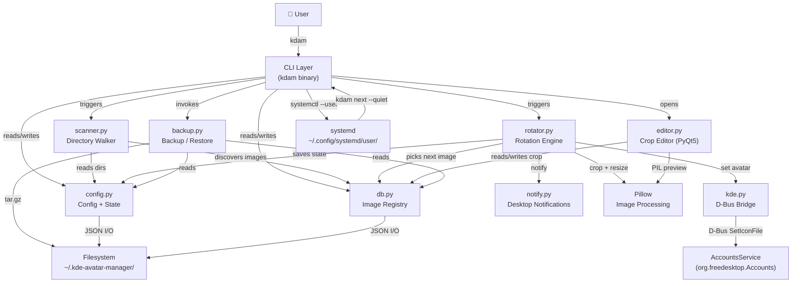

---

## 4. Module Breakdown

### 4.1 Package Entry Point

| File | Purpose |
|------|---------|
| [`__init__.py`](file:///home/mit/Projects/antigravity-manager/kdam/kde-avatar-manager/kdam/__init__.py) | Exposes `__version__ = "1.0.0"` and `__author__` |
| [`__main__.py`](file:///home/mit/Projects/antigravity-manager/kdam/kde-avatar-manager/kdam/__main__.py) | Enables `python -m kdam` |

---

### 4.2 [`config.py`](file:///home/mit/Projects/antigravity-manager/kdam/kde-avatar-manager/kdam/config.py) — Configuration & Paths

**Responsibility:** Define all runtime paths, data structures, and atomic I/O for the configuration file.

#### Constants / Paths

| Constant | Value |
|----------|-------|
| `CONFIG_DIR` | `~/.kde-avatar-manager/` |
| `CONFIG_FILE` | `~/.kde-avatar-manager/config.json` |
| `IMAGES_FILE` | `~/.kde-avatar-manager/images.json` |
| `PROCESSED_DIR` | `~/.kde-avatar-manager/processed/` |
| `BACKUP_FILE` | `~/.kde-avatar-manager/backup.png` |
| `LOGS_DIR` | `~/.kde-avatar-manager/logs/` |
| `LOG_FILE` | `~/.kde-avatar-manager/logs/rotation.log` |
| `AVATAR_SIZE` | `256` px |

#### Dataclasses

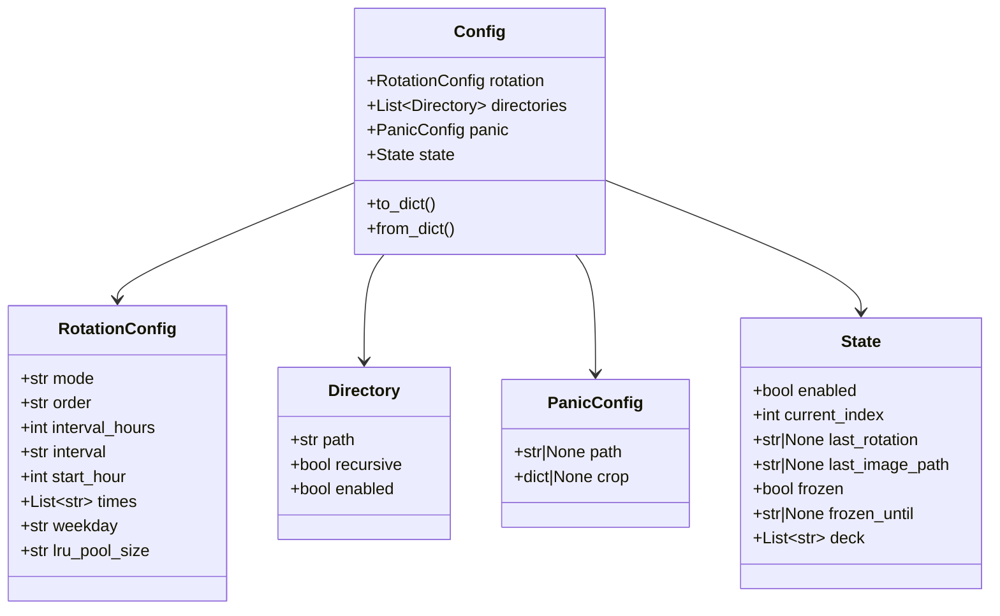

#### Key Functions

| Function | Description |
|----------|-------------|
| `ensure_dirs()` | Create all runtime dirs (`mode=0o700`) + clean stray temp files |
| `cleanup_temp_files()` | Remove stale temp files in `processed/` (keeps `panic.png`) |
| `load_config()` | Exclusive-lock read; corrupt file renamed to `.json.corrupt` |
| `save_config(config)` | Atomic write via temp file + `rename()` under exclusive lock |
| `_db_lock()` | Context manager: `fcntl.flock(LOCK_EX)` on `~/.kde-avatar-manager/.lock` |

> [!IMPORTANT]
> All config I/O is serialized through `_db_lock()` using an exclusive advisory `fcntl` lock. This prevents corruption when the systemd timer fires concurrently with a user command.

---

### 4.3 [`db.py`](file:///home/mit/Projects/antigravity-manager/kdam/kde-avatar-manager/kdam/db.py) — Image Registry

**Responsibility:** JSON-backed registry (`images.json`) mapping resolved absolute paths → `ImageEntry`.

#### Data Classes

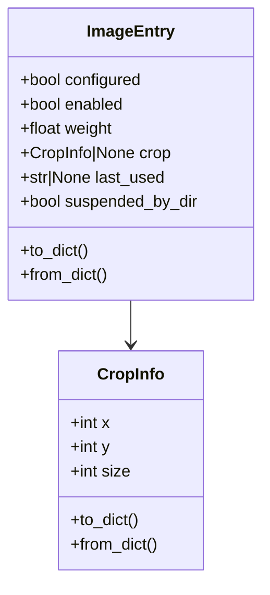

#### `ImageDB` — Key Interface

| Method | Description |
|--------|-------------|
| `has(path)` | Check if path is registered |
| `get(path)` | Return `ImageEntry` or `None` |
| `set(path, entry)` | Upsert an entry (key is resolved absolute path) |
| `remove(path)` | Delete registry entry |
| `all()` | Return copy of full registry dict |
| `active()` | Entries with `configured=True` AND `enabled=True` |
| `unconfigured()` | Entries with `configured=False` |
| `stale()` | Entries whose source file no longer exists on disk |
| `save()` | Atomic write via temp file swap under `_db_lock` |

> [!NOTE]
> All registry keys are **resolved absolute paths** (via `Path.resolve()`). This ensures symlinks and relative paths never cause duplicate entries.

---

### 4.4 [`scanner.py`](file:///home/mit/Projects/antigravity-manager/kdam/kde-avatar-manager/kdam/scanner.py) — Directory Scanner

**Responsibility:** Walk configured directories and discover new image files.

#### Supported Formats

`.jpg`, `.jpeg`, `.png`, `.gif`, `.bmp`, `.webp`, `.tiff`, `.tif`

#### Core Function

```
scan(config, db) → (new_images: list[str], stale_paths: list[str])
```

- Reads `config.directories`, skips disabled ones.
- Calls `_walk_directory(path, recursive)` — uses `os.walk` for recursive, `iterdir()` for flat.
- Validates each candidate with `_is_valid_image()` (Pillow `img.verify()`).
- Adds genuinely new paths to `db` as unconfigured (`configured=False, enabled=False`).
- Returns stale entries (in registry, missing on disk) — **does not remove them** (caller decides).

---

### 4.5 [`rotator.py`](file:///home/mit/Projects/antigravity-manager/kdam/kde-avatar-manager/kdam/rotator.py) — Rotation Engine

**Responsibility:** Select the next image, process it (crop + resize), apply via D-Bus, update state, log, and notify.

#### `process_image(source_path, crop) → Path`

1. Opens source with Pillow → converts to RGBA.
2. Clamps crop coordinates to image bounds (guards against image replacement with smaller files).
3. Crops → resizes to 256×256 (LANCZOS).
4. Writes to a temp file in `PROCESSED_DIR` (same filesystem as KDE data → avoids cross-device move issues).
5. **Returns temp path; caller is responsible for deletion.**

#### `rotate(config, db, quiet=False) → bool | None`

| Return | Meaning |
|--------|---------|
| `True` | Rotation succeeded |
| `False` | Rotation failed (missing file, D-Bus error) |
| `None` | Active pool is empty — caller should not retry |

Full cycle:
1. `get_next_image(config, db)` — pick via selected order.
2. Check file exists on disk.
3. `process_image()` → temp PNG.
4. `kde.set_avatar(processed)` — D-Bus call.
5. Update `entry.last_used`, `config.state`, save both.
6. Write rotation log entry + desktop notification (only if image actually changed).
7. Always delete temp file in `finally`.

#### Selection Orders — `get_next_image()`

| Order | Algorithm |
|-------|-----------|
| `random` | `random.choice()`, avoids repeating last image if > 1 candidate |
| `sequential` | Index modulo pool size; index saved in `config.state.current_index` |
| `weighted` | `random.choices()` with per-image `weight` |
| `lru` | Sort by `last_used` ASC (never-used = epoch 0, tie-broken randomly); pick from top-K pool |
| `deck` | Shuffle-bag: exhausts all images before reshuffling; new images inserted randomly mid-cycle |

#### Error Rate-Limiter

A 1-hour cooldown (`_ERROR_NOTIFY_COOLDOWN_SECS = 3600`) persisted to `~/.kde-avatar-manager/.last_error_notify` prevents notification spam when the systemd timer fires repeatedly into a broken D-Bus environment.

---

### 4.6 [`editor.py`](file:///home/mit/Projects/antigravity-manager/kdam/kde-avatar-manager/kdam/editor.py) — Crop Editor (PyQt5)

**Responsibility:** Interactive GUI for selecting a square crop region from a source image.

#### Architecture

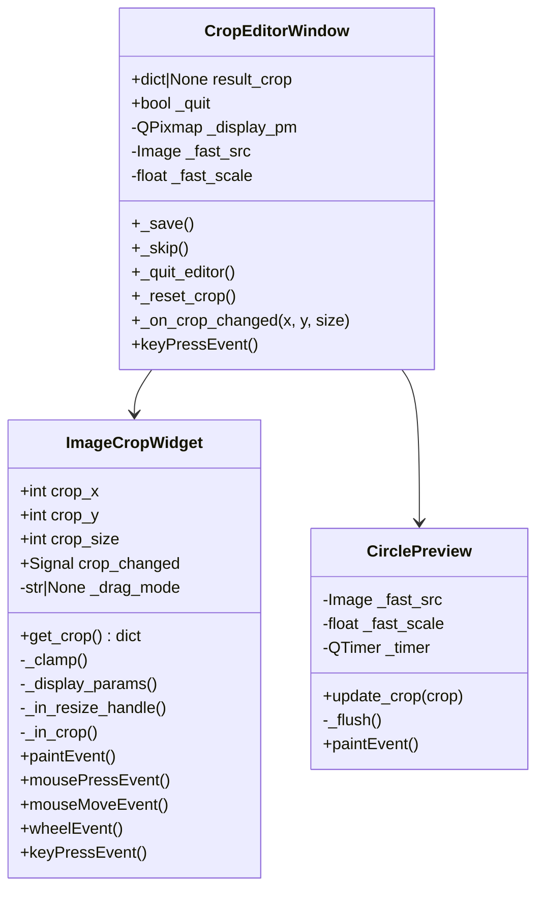

#### Performance Design

| Optimization | Detail |
|---|---|
| Display pixmap pre-scaling | Source downscaled once to ≤1800px at load; `paintEvent` never touches PIL during drag |
| Fast preview source | Separate ≤800px PIL copy for cheap cropping in `CirclePreview` |
| Preview throttling | `QTimer` at 33ms (~30fps) caps PIL work during rapid mouse moves |
| Qt message filtering | Custom handler silences `QFont::fromString` KDE noise |

#### Return Values of `open_crop_editor()`

| Return | Meaning |
|--------|---------|
| `dict {x, y, size}` | User saved a crop |
| `None` | User skipped (closed or clicked Skip) |
| `EDITOR_QUIT` | User clicked Quit (stop `configure-all` loop) |

`EDITOR_QUIT` is a typed singleton (`EditorQuit` class) so `mypy` can verify `result is EDITOR_QUIT` checks.

---

### 4.7 [`kde.py`](file:///home/mit/Projects/antigravity-manager/kdam/kde-avatar-manager/kdam/kde.py) — D-Bus / AccountsService Bridge

**Responsibility:** Set and read the KDE user avatar via the `org.freedesktop.Accounts` D-Bus interface.

| Function | Description |
|----------|-------------|
| `set_avatar(icon_path)` | Calls `org.freedesktop.Accounts.User.SetIconFile`; raises `RuntimeError` on D-Bus failure |
| `get_current_avatar()` | Reads `IconFile` property; returns `None` on failure |
| `backup_current_avatar(dest)` | Copies current avatar file to `dest`; returns `True/False` |

> [!NOTE]
> D-Bus path template: `/org/freedesktop/Accounts/User{uid}` (derived from `os.getuid()`). This is **exactly** the same call KDE System Settings makes internally — no root access is ever required.

---

### 4.8 [`notify.py`](file:///home/mit/Projects/antigravity-manager/kdam/kde-avatar-manager/kdam/notify.py) — Desktop Notifications

**Responsibility:** Fire-and-forget desktop notifications via `notify-send`.

- Silently skips if `notify-send` is not in `PATH`.
- Uses `subprocess.Popen` (non-blocking) to avoid blocking the main process.
- App name: `KDAM`, supports `urgency` levels (`normal`, `critical`).

---

### 4.9 [`backup.py`](file:///home/mit/Projects/antigravity-manager/kdam/kde-avatar-manager/kdam/backup.py) — Backup & Restore

**Responsibility:** Create and restore portable `.tar.gz` archives of the full KDAM state.

#### Backup Types

| Type | Contents |
|------|----------|
| `full` | `kdam_manifest.json` + `config.json` + `images.json` + `backup.png` + source images |
| `metadata_only` | manifest + `config.json` + `images.json` + `backup.png` (no image files) |
| `config_only` | manifest + `config.json` only |

#### Archive Layout

```
kdam_backup_YYYYMMDD_HHMMSS.tar.gz
├── kdam_manifest.json       # version, created_at, original_home, backup_type, …
├── config.json
├── images.json
├── backup.png
└── images/
    ├── 0001_portrait.jpg
    ├── 0002_selfie.png
    └── …
```

#### Restore — Key Features

- **Home path remapping**: `/home/olduser` → `/home/newuser` applied to all paths in `config.json` and `images.json`.
- **Filename collision handling**: If two archived images share the same basename (from different source dirs), they keep their indexed prefix (`0001_`, `0002_`) and a warning is printed.
- **Path traversal guard**: `dest_file.relative_to(img_dest_dir)` ensures extracted paths never escape the target directory.
- **Pre-restore backup**: Existing `backup.png` is renamed to `backup.png.pre-restore` before being overwritten.

---

### 4.10 [`_cli_shared.py`](file:///home/mit/Projects/antigravity-manager/kdam/kde-avatar-manager/kdam/_cli_shared.py) — Shared CLI Utilities

**Responsibility:** All utilities needed by multiple CLI modules; re-exported from `cli.py` for test compatibility.

#### Systemd Helpers

| Function | Description |
|----------|-------------|
| `_write_systemd_files(config)` | Generate `.service` and `.timer` files from current config |
| `_build_timer_directives(config)` | Return `(lines, description)` systemd `[Timer]` block |
| `_systemd(*args)` | Run `systemctl --user *args` |
| `_timer_active()` | Check if timer unit is currently active |
| `_kdam_bin()` | Resolve `kdam` binary path (shutil.which or fallback) |

#### Path & Image Utilities

| Function | Description |
|----------|-------------|
| `_resolve_image_path(query, db)` | Resolve a user query to an absolute registry path (fuzzy match + interactive disambiguation) |
| `_process_panic_image(src, crop)` | Crop+resize → write `processed/panic.png` + `backup.png` |
| `_do_panic_reset(config)` | Apply panic image via D-Bus (shared by `panic reset` and `toggle`) |
| `_ensure_backup()` | Snapshot current KDE avatar to `backup.png` if not yet present |
| `_log_replace_path(old, new)` | Line-aware path migration in `rotation.log` (avoids substring false positives) |
| `_write_log_entry(path)` | Append one ISO-8601 timestamped line to `rotation.log` under lock |
| `_parse_duration(s)` | Parse `"3h"`, `"1w"`, `"12d 13h 52m"` → `timedelta` |
| `_fmt_duration(td)` | Format `timedelta` → human string |

#### Shell Completion Providers

| Function | Completes |
|----------|-----------|
| `_complete_image_name` | Registered image names/paths + filesystem paths |
| `_complete_configured_dirs` | Directories in current config |
| `_complete_command_name` | Top-level kdam commands |
| `_complete_config_key` | Valid `rotation.*` keys |
| `_complete_config_value` | Valid values for a given config key |

---

### 4.11 [`cli.py`](file:///home/mit/Projects/antigravity-manager/kdam/kde-avatar-manager/kdam/cli.py) — Root CLI Group & Leaf Commands

**Responsibility:** Defines the root `cli` Click group and all top-level leaf commands. Sub-groups (`config`, `dirs`, `panic`, `backup`) are registered here by being imported.

The root group is the Click entry point: `kdam = "kdam.cli:cli"`.

#### Commands Defined Directly in `cli.py`

| Command | Description |
|---------|-------------|
| `help [command]` | Rich-rendered full reference or per-command help |
| `scan` | Walk directories, register new images, report stale |
| `list [-p]` | Rich table of all registered images with status/crop/weight |
| `add <paths>` | Add images + open crop editor |
| `remove [paths] [--stale] [--all-unconfigured] [--delete-file]` | Remove from registry |
| `unconfigure <paths>` | Reset crop, return to unconfigured state |
| `rename <old> <new>` | Rename on disk + migrate all references (DB, config, log) |
| `edit <path>` | Re-open crop editor for an existing image |
| `configure [paths]` | Open crop editor for specified or all unconfigured images |
| `configure-all` | Batch crop editor for every unconfigured image |
| `set <path>` | Apply specific image immediately via D-Bus |
| `freeze [dur] [-i path]` | Freeze rotation indefinitely or for duration |
| `unfreeze [-r]` | Unfreeze; optional immediate rotation |
| `next [--count N] [--dry-run] [--quiet]` | Trigger rotation; used by systemd service |
| `status` | Full status display (timer, freeze, counts, next run time) |
| `log [-n N] [--all] [--desc] [--prune N]` | Rotation history |
| `resync` | Re-link registry after files moved in a file manager |
| `enable-image / disable-image` | Toggle individual image in rotation pool |
| `weight <path> <n>` | Set per-image weight for weighted-random mode |
| `enable / disable / toggle` | Install/start or stop/disable systemd timer |
| `completion [--shell bash|zsh|fish]` | Shell completion setup instructions |
| `uninstall [--purge] [-y]` | Stop timer, remove binary |

---

### 4.12 [`cli_config.py`](file:///home/mit/Projects/antigravity-manager/kdam/kde-avatar-manager/kdam/cli_config.py) — Config Sub-group

| Sub-command | Description |
|-------------|-------------|
| `config show` | Print full config as JSON |
| `config set <key> <value>` | Validate and set rotation config fields; auto-reload systemd timer if active |

Config keys: `rotation.mode`, `rotation.order`, `rotation.interval`, `rotation.interval_hours`, `rotation.start_hour`, `rotation.times`, `rotation.weekday`, `rotation.lru_pool_size`

---

### 4.13 [`cli_dirs.py`](file:///home/mit/Projects/antigravity-manager/kdam/kde-avatar-manager/kdam/cli_dirs.py) — Dirs Sub-group

| Sub-command | Description |
|-------------|-------------|
| `dirs list` | Show configured directories with status |
| `dirs add <path> [-r]` | Add directory (recursive or flat) |
| `dirs remove <path>` | Remove from scan config (images stay in registry) |
| `dirs toggle <path>` | Enable/disable scanning (images stay active) |
| `dirs edit <path>` | Show or change recursive flag |
| `dirs suspend <path>` | Disable scanning + pause all images from this dir (`suspended_by_dir=True`) |
| `dirs resume <path>` | Re-enable scanning + restore all dir-suspended images |

---

### 4.14 [`cli_panic.py`](file:///home/mit/Projects/antigravity-manager/kdam/kde-avatar-manager/kdam/cli_panic.py) — Panic Sub-group

| Sub-command | Description |
|-------------|-------------|
| `panic reset` | Apply panic image via D-Bus + disable rotation |
| `panic set <path> [--current] [--no-editor]` | Designate panic image; optionally snapshot current KDE avatar |
| `panic snapshot` | Capture current KDE avatar → `backup.png` |
| `panic edit` | Re-crop the panic image; syncs `processed/panic.png` + `backup.png` |
| `panic show` | Display configured panic image path + backup status |

---

### 4.15 [`cli_backup.py`](file:///home/mit/Projects/antigravity-manager/kdam/kde-avatar-manager/kdam/cli_backup.py) — Backup Sub-group

| Sub-command | Description |
|-------------|-------------|
| `backup create [path] [--no-images] [--config-only]` | Create `.tar.gz` archive |
| `backup info <archive>` | Inspect manifest without restoring |
| `backup restore <archive> [-d dir] [-f]` | Restore config, metadata, images |

---

## 5. Data Model

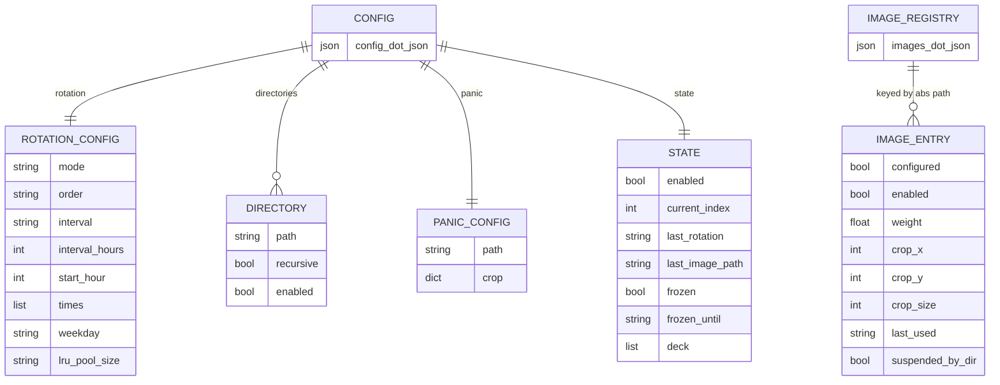

---

## 6. Data Flow Diagrams

### 6.1 Normal Rotation Cycle

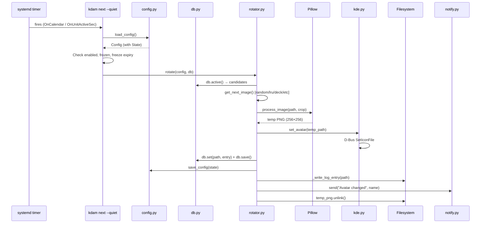

### 6.2 Panic Reset Flow

```mermaid
sequenceDiagram
    participant U as User
    participant CLI as kdam panic reset
    participant C as config.py
    participant SH as _cli_shared.py
    participant P as Pillow
    participant K as kde.py
    participant SD as systemd

    U->>CLI: kdam panic reset
    CLI->>C: load_config()
    CLI->>SH: _do_panic_reset(config)
    SH->>SH: resolve panic source (config.panic.path or backup.png)
    SH->>P: _process_panic_image(src, crop)
    P-->>SH: processed/panic.png (256×256)
    SH->>K: set_avatar(panic.png)
    SH->>C: save_config()
    CLI->>C: config.state.enabled = False; save_config()
    CLI->>SD: systemctl --user stop kde-avatar-rotate.timer
    CLI-->>U: ✓ Panic reset applied
```

### 6.3 Crop Editor Integration

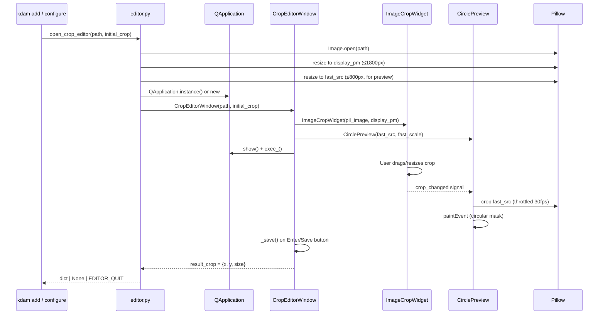

### 6.4 Backup & Restore Flow

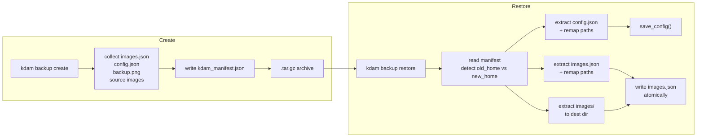

---

## 7. File System Layout at Runtime

```
~/.kde-avatar-manager/          (mode 0700)
├── config.json                 # Full Config dataclass (rotation, dirs, panic, state)
├── images.json                 # ImageDB: abs_path → ImageEntry
├── backup.png                  # Snapshot of original KDE avatar (panic fallback)
├── .lock                       # Advisory fcntl lock file
├── .last_error_notify          # Timestamp of last error notification (rate limiter)
├── processed/
│   ├── panic.png               # Cropped+resized panic image (persisted)
│   └── *.png                   # Temp files from in-progress rotations (cleaned up)
└── logs/
    └── rotation.log            # Append-only log: "ISO8601 | /abs/path/to/image\n"

~/.config/systemd/user/
├── kde-avatar-rotate.service   # Oneshot service: kdam next --quiet
└── kde-avatar-rotate.timer     # Calendar/interval timer
```

---

## 8. Concurrency & Safety Model

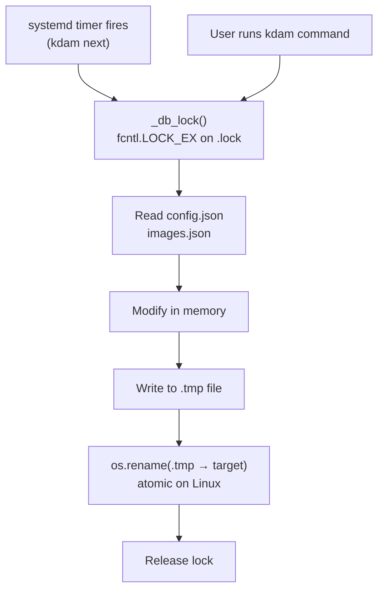

**Key safety properties:**

- **Mutual exclusion**: `fcntl.flock(LOCK_EX)` on `~/.kde-avatar-manager/.lock` serializes all reads and writes, whether from the systemd timer or the user's terminal.
- **Atomic writes**: All JSON files are written to a `.tmp` sibling then `os.rename()`'d into place, so a crash mid-write never leaves a corrupt file.
- **Corrupt file handling**: If `config.json` or `images.json` is corrupt (invalid JSON), it is renamed to `.json.corrupt` and defaults are loaded.
- **Temp file cleanup**: `cleanup_temp_files()` removes stale temp PNGs from `processed/` on every `ensure_dirs()` call.
- **TOCTOU guard in rename**: `os.open(O_CREAT | O_EXCL)` atomically claims the destination slot before `shutil.move()`, preventing races between existence check and rename.

---

## 9. Systemd Integration

### Unit Files

KDAM generates its own user-scoped systemd units in `~/.config/systemd/user/`:

**Service** (`kde-avatar-rotate.service`):
```ini
[Unit]
Description=KDE Avatar Auto-Rotator
After=graphical-session.target
Wants=graphical-session.target

[Service]
Type=oneshot
ExecStartPre=/bin/sleep 5
ExecStart=/home/user/.local/bin/kdam next --quiet
```

**Timer** (`kde-avatar-rotate.timer`) — dynamically generated from config:

| Rotation mode | Systemd directive example |
|---------------|--------------------------|
| `daily` | `OnCalendar=daily` |
| `weekly` | `OnCalendar=Mon *-*-* 00:00:00` |
| `monthly` | `OnCalendar=*-*-01 00:00:00` |
| `times` | `OnCalendar=*-*-* 08:00:00` (repeated per time) |
| `interval` (clock-aligned, e.g. 6h) | `OnCalendar=*-*-* 00,06,12,18:00:00` |
| `interval` (arbitrary, e.g. 45m) | `OnBootSec=1min` + `OnUnitActiveSec=45m` |

All timer modes add `Persistent=true` (catches missed fires) and `RandomizedDelaySec=30s` (avoids thundering herd on multi-user systems).

### Lifecycle Commands

| Command | Effect |
|---------|--------|
| `kdam enable` | Write unit files → `daemon-reload` → `enable --now` timer |
| `kdam disable` | `stop` + `disable` timer |
| `kdam toggle` | If timer active: `panic reset` + `disable`; if inactive: `enable` |
| `config set rotation.*` | Rewrites timer file → `daemon-reload` → `restart` timer (auto, if active) |

---

## 10. Rotation Modes & Selection Orders

### Rotation Modes (Schedule)

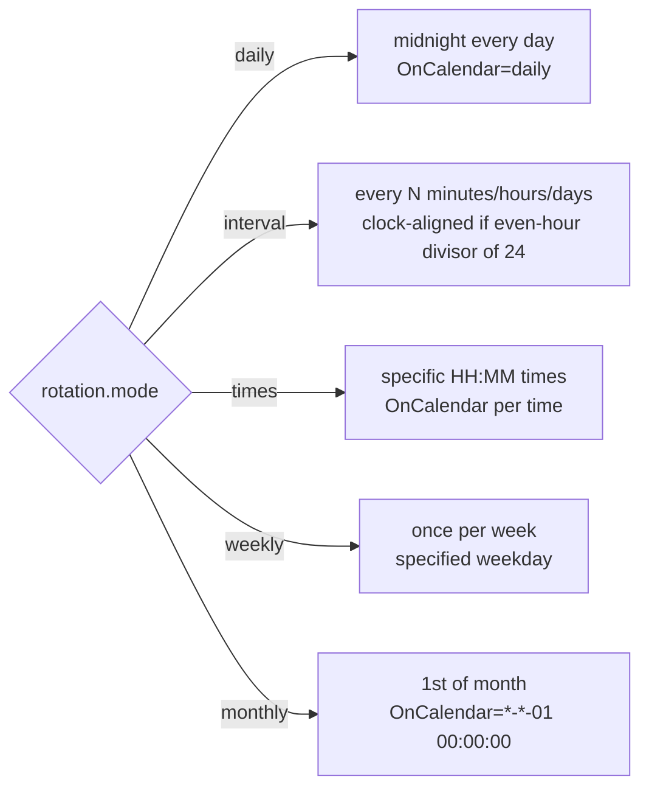

### Selection Orders (Pool)

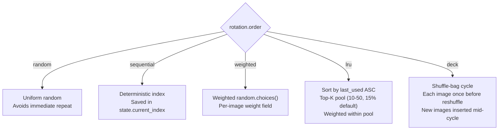

---

## 11. CLI Command Reference Tree

```
kdam
├── help [command_name...]
├── scan
├── list [-p]
├── add <paths...> [--no-editor]
├── remove [paths] [--stale] [--all-unconfigured] [--delete-file]
├── unconfigure <paths...>
├── rename <old> <new>
├── edit <path>
├── configure [paths...]
├── configure-all
├── set <path>
├── freeze [duration] [-i path]
├── unfreeze [-r]
├── next [--quiet] [-c N] [--dry-run]
├── status
├── log [-n N] [--all] [--desc] [--prune N]
├── resync
├── enable-image <path>
├── disable-image <path>
├── weight <path> <n>
├── enable
├── disable
├── toggle
├── completion [--shell bash|zsh|fish]
├── uninstall [--purge] [-y]
│
├── config
│   ├── show
│   └── set <key> <value>
│
├── dirs
│   ├── list
│   ├── add <path> [-r]
│   ├── remove <path>
│   ├── toggle <path>
│   ├── edit <path> [--recursive|--no-recursive]
│   ├── suspend <path>
│   └── resume <path>
│
├── panic
│   ├── reset
│   ├── set [path] [--current] [--no-editor]
│   ├── snapshot
│   ├── edit
│   └── show
│
└── backup
    ├── create [path] [--no-images] [--config-only]
    ├── info <archive>
    └── restore <archive> [-d dir] [-f]
```

---

## 12. Dependency Graph

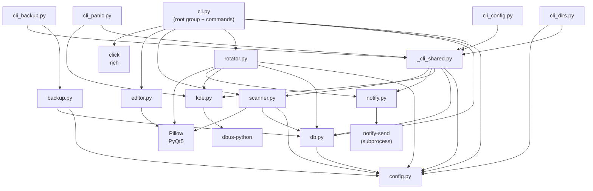

### External Dependencies

| Package | Version | Used For |
|---------|---------|----------|
| `click` | ≥ 8.0 | CLI framework, argument parsing, shell completion |
| `Pillow` | ≥ 9.0 | Image open/crop/resize/verify |
| `rich` | ≥ 12.0 | Rich terminal output (tables, panels, colors) |
| `PyQt5` | ≥ 5.15 | Crop editor GUI |
| `dbus-python` | any | D-Bus connection to `org.freedesktop.Accounts` |

---

## 13. Test Suite

Located in [`tests/`](file:///home/mit/Projects/antigravity-manager/kdam/kde-avatar-manager/tests/), using `pytest` + `hypothesis`.

| Test File | Coverage Area |
|-----------|--------------|
| `test_config.py` | Config load/save, corrupt handling, dataclass round-trips |
| `test_db.py` | ImageDB CRUD, stale detection, atomic save |
| `test_scanner.py` | Directory walking, image validation, new/stale detection |
| `test_rotator.py` | All selection orders, freeze logic, process_image, error rate-limiter |
| `test_editor.py` | CropEditorWindow, ImageCropWidget, EDITOR_QUIT sentinel |
| `test_cli.py` | CLI command smoke tests |
| `test_cli_extended.py` | Extended CLI scenarios |
| `test_backup.py` | Create/restore cycle, path remapping, conflict handling |
| `test_dbus_integration.py` | D-Bus mocking/integration |
| `test_e2e.py` | End-to-end rotation scenarios |
| `test_fuzz_and_smoke.py` | Hypothesis-based fuzz tests |
| `test_healthcheck.py` | System state health checks |
| `test_option_audit.py` | CLI option completeness audit |
| `test_systemd_consistency.py` | Systemd unit file generation consistency |
| `test_uninstall.py` | Uninstall command behavior |
| `conftest.py` | Shared fixtures |
| `helpers.py` | Test utility functions |

---

## 14. Technology Stack

| Layer | Technology |
|-------|------------|
| Language | Python 3.11+ |
| CLI framework | [Click](https://click.palletsprojects.com/) ≥ 8.0 |
| Terminal UI | [Rich](https://rich.readthedocs.io/) ≥ 12.0 |
| Image processing | [Pillow](https://pillow.readthedocs.io/) ≥ 9.0 |
| Crop editor GUI | [PyQt5](https://riverbankcomputing.com/software/pyqt/) ≥ 5.15 |
| KDE D-Bus integration | [dbus-python](https://dbus.freedesktop.org/doc/dbus-python/) |
| Desktop notifications | `notify-send` (subprocess, optional) |
| Scheduling | `systemd --user` (timer + service) |
| Persistence | JSON files + `fcntl` advisory locking |
| Build system | setuptools ≥ 61 (`pyproject.toml`) |
| Testing | pytest ≥ 7.0 + hypothesis ≥ 6.0 |
| Type checking | mypy ≥ 1.0 |
| Linting | ruff (E, F, I, B, UP rules) |
| CI | GitHub Actions (`.github/workflows/ci.yml`) |
